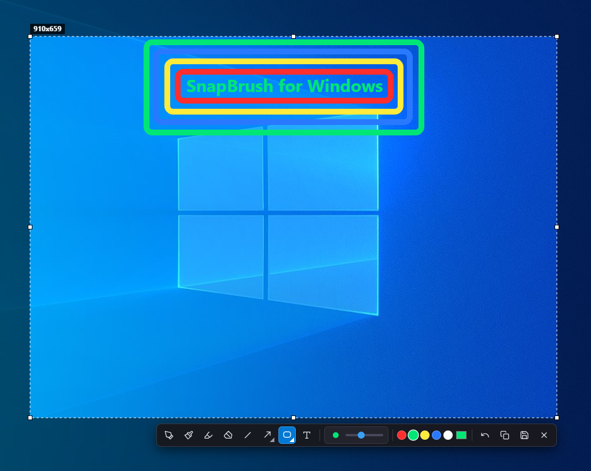

<div align="center">
  
  <h1>SnapBrush</h1>
  <p><strong>Ferramenta Open Source de captura de tela e anotação rápida para Windows 10 e 11 (x64)</strong></p>
  <p>
    
    
    
  </p>
</div>

## Sobre o Projeto

O **SnapBrush** é um utilitário leve de captura e edição de tela em tempo real que opera silenciosamente na bandeja do sistema (System Tray). Ele foi desenvolvido para oferecer uma alternativa moderna, gratuita e de código aberto a programas como o a Ferramenta de Captura do Windows, reunindo muito mais opções de desenho, setas, formas e camadas.

> **Aviso Legal (Projeto Não Oficial):** O SnapBrush é um software independente, open-source e **não oficial**, sem nenhuma relação com a Microsoft Corporation ou instituições terceiras. Desenvolvido com foco em desempenho, ele se integra perfeitamente ao sistema operacional para entregar a agilidade e a naturalidade de um aplicativo nativo do Windows.

## Interface em Ação

Ao pressionar `PrintScreen`, ou clicar sobre o icone do `SnapBrush`, que fica na barra de tarefas do Windows, a tela congela instantaneamente permitindo selecionar e ajustar a área exata do recorte, visualizar as dimensões em pixels (`Largura x Altura`) e utilizar a barra flutuante de anotações:

<div align="center">
  
</div>


## Principais Funcionalidades

* **Seleção Ajustável com Medidor de Pixels:** Borda pontilhada com 8 alças de redimensionamento e indicador de resolução (`Largura x Altura`) em tempo real.
* **Desenho em Camada Independente:** Caneta, Pincel macio com suavização e Marca-texto inteligente que destaca textos sem cobrir a leitura.
* **Borracha Dedicada:** Apaga qualquer anotação, seta ou texto desenhado sem afetar a imagem de fundo da captura.
* **Múltiplos Estilos de Setas e Formas:** Setas simples, duplas, pontilhadas e curvas, além de linhas retas e retângulos (borda, arredondado e preenchido).
* **Controle Dinâmico de Espessura:** Ajuste contínuo em barra estilo volume ou diretamente pela roda do mouse (Scroll), com círculo de pré-visualização em tempo real.
* **Ferramenta de Texto Ágil:** Insere textos na cor e proporção selecionadas ao pressionar `Enter` ou simplesmente ao clicar fora da caixa de digitação.
* **Integração com a Bandeja do Windows:** Notificações nativas ao copiar ou salvar, configuração de inicialização automática com o Windows e personalização de teclas de atalho.

## Atalhos Padrão

| Ação | Atalho Padrão | Personalizável |
| :--- | :--- | :--- |
| Iniciar recorte de tela | `PrintScreen` | Sim (Menu Opções) |
| Salvar tela inteira | `Shift + PrintScreen` | Sim (Menu Opções) |
| Copiar tela inteira | `Ctrl + PrintScreen` | Sim (Menu Opções) |
| Copiar área selecionada | `Ctrl + C` | Fixo no editor |
| Salvar área selecionada | `Ctrl + S` | Fixo no editor |
| Desfazer última ação | `Ctrl + Z` | Fixo no editor |
| Cancelar captura | `Esc` | Fixo no editor |

Todos os atalhos globais podem ser habilitados, desabilitados ou alterados clicando com o botão direito no ícone do **SnapBrush** na bandeja do Windows e selecionando **Opções...**.

## Como Instalar (Para Usuários)

1. Acesse a aba [**Releases**](../../releases) deste repositório.
2. Baixe o instalador **`SnapBrush Setup 1.0.0.exe`** na versão mais recente.
3. Execute o instalador, escolha o diretório de sua preferência e conclua a instalação.
4. O ícone da tesoura com pincel aparecerá na bandeja do sistema (próximo ao relógio do Windows). Pressione `PrintScreen` para começar a usar.

## Como Executar e Compilar o Código-Fonte (Para Desenvolvedores)

### Pré-requisitos
* **Node.js** (versão 20 LTS ou superior)
* **Git** instalado no sistema

### Passo a passo no terminal

1. Clone o repositório e acesse a pasta do projeto:
   ```bash
   git clone https://github.com/KevinStoneTech/SnapBrush.git
   cd SnapBrush
   ```

2. Instale as dependências do projeto:
   ```bash
   npm install
   ```

3. Execute em modo de desenvolvimento:
   ```bash
   npm start
   ```

4. Gere o instalador `.exe` otimizado para Windows 10 e 11 (x64):
   ```bash
   npm run dist
   ```
   O instalador final será gerado dentro da pasta `dist/`.

## Estrutura de Arquivos do Projeto

* `main.js`: Processo principal em segundo plano, gerenciamento da bandeja do sistema, notificações nativas, atalhos globais e persistência de configurações (`AppData`).
* `index.html`: Interface da camada de sobreposição (overlay) e barra de ferramentas compacta em SVG.
* `editor.js`: Motor gráfico em HTML5 Canvas com camada independente para anotações, cálculo geométrico de setas e histórico de ações.
* `options.html`: Janela de configurações gerais (inicialização com o Windows, alertas e atalhos).
* `about.html`: Janela informativa com versão e licença do software.
* `afterPack.js`: Script de otimização que remove pacotes de idiomas não utilizados e arquivos redundantes durante a geração do instalador.

## Como Contribuir

Contribuições são muito bem-vindas! Se você deseja adicionar novas ferramentas, melhorar a performance ou corrigir problemas:

1. Faça um **Fork** deste repositório.
2. Crie uma branch para sua melhoria (`git checkout -b feature/nova-ferramenta`).
3. Faça o commit das suas alterações (`git commit -m "Adiciona nova ferramenta"`).
4. Envie para o seu repositório (`git push origin feature/nova-ferramenta`).
5. Abra um **Pull Request** detalhando as melhorias realizadas.

## Licença

Este projeto é distribuído sob a licença **MIT**. Consulte o arquivo [LICENSE](LICENSE) para mais detalhes.